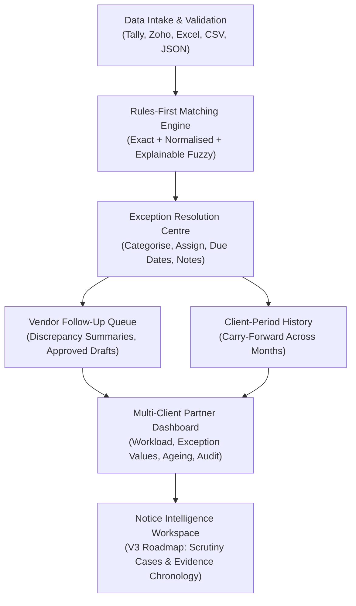

# TEEOR PRODUCT BLUEPRINT
### What to build, why customers need it, and how the product should evolve
**A product requirements and roadmap document for an AI-powered GST operations platform serving Indian Chartered Accountant firms.**

━━━━━━━━━━━━━━━━━━━━━━━━━━━━━━━━━━━━━━━━━━━━━━━━━━  
**Document status:** Working product blueprint — for founder, product, engineering, and outreach teams  
**Version:** 1.1 (Refined)  
**Date:** 9 November 2026 (Updated 10 November 2026)  
**Product name:** Teeor (working name; subject to trademark and domain checks)  
**Primary market:** India — CA firms and tax practices  
**CONFIDENTIAL — INTERNAL PLANNING DOCUMENT**  

---

## Document Control

| Item | Description |
| :--- | :--- |
| **Purpose** | Translate the Teeor Company Book into a practical product specification: customer problems, existing solutions, differentiation hypotheses, V1 scope, technical foundations, roadmap, and sales validation. |
| **Audience** | Founders, product manager, engineering, design, research and outreach, CA-domain advisors, and pilot firms. |
| **Primary source** | Teeor Company Book, October 2026, especially the problem, product, customer, competition, pricing, go-to-market, trust, and 90-day plan sections. |
| **Research snapshot** | Public competitor and official GST information reviewed on 9 November 2026. Product pages describe vendor-advertised capabilities and are not independent performance audits. |
| **Decision status** | Recommended direction for validation. Product scope and pricing must be revised after CA interviews and real-data pilots. |

---

## Contents
1. Executive Product Decision
2. Product Vision, Target Customer, and Users
3. Problems CA Firms Face
4. Existing Solutions and Competitive Landscape
5. Where Teeor Can Win — Differentiation Hypotheses
6. Proposed Product and End-to-End Workflow
7. Functional Modules and Requirements
8. Version Roadmap: V0 to Future Scope
9. V1 MVP — Detailed Build Specification
10. Technical Architecture and Data Model
11. Trust, Security, and Compliance Guardrails
12. Metrics and Acceptance Criteria
13. Pilot, Sales, and Pricing Strategy
14. 90-Day Execution Plan and Team Ownership
15. Risks, Assumptions, and Decisions to Validate
- Appendix A: CA Discovery Interview Guide
- Appendix B: First Product Demonstration Script
- Appendix C: Research Sources

---

## 1. Executive Product Decision

Teeor should be built as a **multi-client GST operations and exception-resolution workspace for CA firms**. The first product must reconcile a client’s Purchase Register against GSTR-2B, explain exceptions, help staff take the next action, preserve review decisions, and show partners what remains unresolved.

> [!IMPORTANT]
> **Recommended Positioning:**  
> Teeor helps CA firms move GST work **from reconciliation to resolution** — with one reviewable workflow across clients, staff, suppliers, and supporting evidence.

### The Decision in One Page

| Question | Recommendation |
| :--- | :--- |
| **Who pays?** | A CA firm or tax practice. Start with small and mid-sized firms that manage many recurring GST clients. |
| **Who uses it daily?** | Article assistants, accountants, GST executives, and managers who prepare and review reconciliations. |
| **What is the first job?** | Reconcile Purchase Register vs GSTR-2B and turn exceptions into assigned, traceable work. |
| **What must V1 prove?** | It can process real client files reliably, save measurable staff time, produce reviewable matching suggestions, and help close exceptions. |
| **What is not V1?** | Autonomous GST filing, legal/tax advice, bookkeeping replacement, full practice management, every GST return, TDS, and international tax. |
| **Why could customers pay?** | Reduced manual effort, fewer missed follow-ups, clearer partner oversight, and a repeatable monthly workflow — demonstrated with their own data. |

### Important Market Reality

The category is already competitive. ClearTax/Clear, TallyPrime, AI Accountant, Zoho Books, and Masters India advertise GST reconciliation capabilities. Clear and AI Accountant also advertise functionality around notices, audit trails, or follow-up workflows. Xegality markets both notice workflows and broader CA-firm tools, while Turia offers practice-management capabilities. Therefore, **“AI-powered reconciliation” or “AI notice drafting” alone is not a defensible differentiator.**

The product thesis to test is narrower: **Teeor can win by making post-reconciliation work — triage, ownership, supplier chase, carry-forward, evidence collection, review, and cross-client oversight — easier to execute in one consistent workflow, especially for firms working across existing accounting systems.** This is a hypothesis to validate through pilots, not an assumed market vacuum.

---

## 2. Product Vision, Target Customer, and Users

### 2.1 Product Vision
Become the operational layer that helps CA firms complete recurring GST work across many client businesses. Teeor should not replace Tally, Zoho, Clear, or the GST portal in V1. It should connect the firm’s data and people, reduce repetitive manual work, and give the CA a controlled approval point.

### 2.2 Ideal Customer Profile (Initial)

| Attribute | Initial Target |
| :--- | :--- |
| **Firm type** | Independent CA practice or GST-focused tax/accounting firm. |
| **Firm size** | Approximately 1–3 partners and 5–20 staff; validate range through discovery. |
| **Client base** | Approximately 50–300 GST-registered client businesses, with meaningful monthly purchase invoice volume. |
| **Current workflow** | Tally and/or Zoho exports, GST portal downloads, Excel workbooks, email, and WhatsApp follow-ups. |
| **Pain signal** | Recurring time spent reconciling, investigating exceptions, chasing suppliers, and tracking unresolved items. |
| **Buying trigger** | Monthly close pressure, staff capacity limits, recurring mismatches, difficulty supervising multiple clients, or a desire to standardize work. |
| **Decision-maker** | Partner, proprietor, or GST practice head. |
| **Internal champion**| GST manager, senior accountant, article assistant, or tax executive. |

### 2.3 User Roles and Jobs to be Done

| User | Job to be Done | What Teeor Must Provide |
| :--- | :--- | :--- |
| **Managing Partner** | Know which client work is complete, risky, overdue, or blocked. | Firm-wide dashboard, exception value summary, deadlines, staff ownership, and audit history. |
| **GST Manager / Reviewer** | Review work consistently and clear escalations. | Review queue, filters, bulk triage, maker-checker approval controls, and review notes. |
| **Article Assistant / Accountant** | Finish reconciliations and chase missing or incorrect invoices. | Fast upload, suggested matches, clear mismatch reasons, assignments, and communication drafts. |
| **Client Business / Vendor** | Understand what information is missing or needs correction. | Clear, accurate, approved requests and a secure way to provide missing documents where enabled. |
| **Teeor Admin / Support** | Resolve import, mapping, and access problems safely. | Job logs, validation reports, access controls, and support tooling without broad client-data exposure. |

---

## 3. Problems CA Firms Face

| Problem | What Happens Today | Business Impact | Teeor Response |
| :--- | :--- | :--- | :--- |
| **1. Data collection & inconsistent files** | Staff collect Purchase Registers, GSTR-2B files, Tally/Zoho exports, and CSVs. Formats, column names, and completeness vary. | Time lost chasing files, reformatting sheets, and correcting imports. | A guided intake and validation layer: upload files, detect format, map columns, flag missing fields, and show row-level import errors before matching. |
| **2. Invoice-level reconciliation** | Staff compare supplier GSTIN, document number/date, taxable value, and tax amounts across books and portal statements. | High-volume repetitive work; manual formulas and inconsistent matching miss or misclassify records. | A rules-first matching engine with normalization, controlled fuzzy suggestions, match reasons, confidence bands, and reviewer approval. |
| **3. Exceptions are hard to interpret** | A basic "unmatched" status does not explain whether the cause is a missing supplier filing, a book-entry typo, a period shift, or a duplicate. | Staff must investigate each case; partners struggle to distinguish actionable exceptions from timing differences. | An exception taxonomy with evidence, likely cause, next action, and an explicit "needs CA review" state. |
| **4. Missing invoices cross months** | A supplier may report an invoice in a later return period; an issue can remain open across multiple monthly cycles. | Teams repeat investigation or lose the original context and follow-up history. | Carry forward cases across periods, preserve original period, link later matches, and keep a resolution timeline. |
| **5. Vendor follow-up is fragmented** | Supplier communication happens through calls, email, and WhatsApp, outside the reconciliation workbook. | Repeated chasing, duplicate messages, no clear owner, and uncertainty about whether the issue was resolved. | A vendor-wise action queue, approved message drafts, reminders, communication log, and links back to invoice exceptions. |
| **6. Staff ownership & review are unclear** | Work is spread across staff, spreadsheets, and partner chats. | Items remain unassigned; handoffs fail; managers cannot see bottlenecks. | Assign owner, due date, reviewer, and status; escalate overdue issues; maintain maker-checker history. |
| **7. ITC impact is hard to prioritize** | A long mismatch list does not clearly show related tax amounts, GSTIN, period, and current disposition. | Staff spend time on low-value items while material issues remain unresolved. | Show tax amount and issue age as prioritization indicators. Label values as "under review / at risk", not as guaranteed recoverable ITC. |
| **8. Notices require evidence gathering** | A notice requires understanding allegations, locating records, checking prior returns, and assembling evidence. | Deadline pressure, repeated document collection, and inconsistent drafting quality. | Later notice workspace linked to client, period, reconciliations, evidence, and CA-approved drafts. |
| **9. Partner lacks multi-client visibility** | Partners oversee dozens or hundreds of GST clients across multiple staff and software tools. | Difficult to know completion status, open exceptions, overdue work, and risk at a glance. | Multi-client dashboard, filters by GSTIN/client/period, exception totals, ageing, owner, and status. |
| **10. Auditability and handover** | Match decisions or manual corrections lack a clear record of who approved them and why. | Difficult reviews, staff transitions, and later enquiries. | Immutable event history for imports, match decisions, overrides, comments, approvals, and exports. |
| **11. Tool fragmentation** | Accounting, GST filing, practice management, messaging, and notice tools are separate. | Duplicate data entry and multiple sources of truth. | Start with exports and links; add integrations when supported by demand and authorized access. Avoid replacing systems of record in V1. |
| **12. Trust and data sensitivity** | The workflow uses client GST information, invoices, vendor details, and potentially notices. | A security incident or unauthorized action could damage client trust and expose the firm to risk. | Tenant isolation, least-privilege roles, encryption, retention/deletion controls, data processing terms, and human approval. |

### 3.1 Official GST Process Context
- **GSTR-2B:** GSTN defines GSTR-2B as a read-only, static auto-drafted ITC statement populated from supplier filings. It assists in determining ITC for GSTR-3B, but does not itself establish that every reflected credit is legally eligible; taxpayers must self-assess under applicable provisions (Section 16, Section 17(5)). Teeor surfaces records and evidence, but must not present a "matched" invoice as a legal conclusion that ITC is claimable.
- **DRC-01C & ASMT-10:** DRC-01C is an online intimation for differences between GSTR-2B available ITC and GSTR-3B claimed ITC (with Part B response requirements affecting subsequent GSTR-1 filings). ASMT-10 is a scrutiny notice under Rule 99. Teeor models notice types and statutory timelines separately, with all final responses signed off by qualified CAs.

---

## 4. Existing Solutions and Competitive Landscape

| Solution | Publicly Advertised Capabilities | Market Position | Implication for Teeor |
| :--- | :--- | :--- | :--- |
| **ClearTax / Clear** | GST filing & reconciliation; AI invoice matching; vendor reminders; IMS, notice tracking, audit trails. | Strong brand, comprehensive indirect-tax suite. | Do not compete on matching speed or feature breadth. Test whether mid-sized CA firms need a simpler, source-neutral exception-resolution layer. |
| **TallyPrime** | Imports/downloads GSTR-2B; reconciles books with portal; classifies matched, mismatched, missing in books/portal. | Default accounting system for Indian MSMEs and CA firms. | Integrate with/export from Tally. Focus on multi-client team ownership, exception follow-through, and audit trails rather than replacing accounting. |
| **AI Accountant** | PR + GSTR-2B/2A upload/API; fuzzy matching; credit/debit note recon; missing invoice carry-forward; Table 4. | Direct overlap with reconciliation mechanics. | Reconciliation alone is a commodity. Win on workflow usability, exception closure, onboarding speed, and firm-level partner oversight. |
| **Zoho Books** | Fetches GSTR-2B via GST portal; categorizes matches; supports create/modify/match actions. | Native workflow for Zoho users. | Be useful across firms using different ledgers; do not require migration into Zoho. |
| **Masters India** | Configurable GSTR-2B vs PR recon jobs; auto-accept rules and tolerance values; vendor-wise reports. | GST-focused configuration and reporting. | Differentiate on exception ownership, communication history, cross-period closure, and partner-level visibility. |
| **Xegality** | Notice playbooks, deadlines, evidence checklists, AI point-wise drafts; CA portal for ITC recon and vendor chases. | Direct overlap in notices and CA workflows. | Do not claim notice drafting or vendor reminders are unique. Focus on an intuitive monthly GST exception resolution workflow with seamless onboarding. |
| **Turia** | CA practice-management platform: client, tasks, compliance, notices, communication, billing. | Broad practice operations and low entry pricing. | Do not build generic CRM/task management. Provide GST-specific structured cases and invoice/evidence-level context. |
| **Spreadsheets & WhatsApp** | Staff export data, write VLOOKUPs, track issues in workbooks, and call/message suppliers manually. | Familiar, flexible, zero software procurement friction. | Win on less rework, reliable audit history, clear assignments, and measurable hours saved — not on "AI" branding. |

---

## 5. Where Teeor Can Win — Differentiation Hypotheses

| Hypothesis | What Teeor Does | Validation Metric |
| :--- | :--- | :--- |
| **A. Exception closure, not just match reporting** | Give each mismatch an owner, recommended next action, due date, communication history, evidence, and status. | Time to close exceptions; review-to-resolution cycle. |
| **B. Cross-client operating queue** | Allow a partner or manager to see next actions across many GSTINs and clients, not just a single ledger. | Partner time spent chasing article trainees for status updates. |
| **C. Source-neutral workflow** | Ingest Tally, Zoho, and custom Excel files without forcing client accounting migrations. | Mapping effort, import failure rate, time from login to first recon. |
| **D. Explainable match decisions** | Show matching keys, normalization applied, alternatives considered, and why a match was proposed. | Reviewer approval rate, false-positive rate, time per review on labeled samples. |
| **E. Evidence connected to the issue** | Keep supporting files, supplier messages, prior periods, and reviewer decisions attached to the exception. | Document retrieval time during audits and scrutiny replies. |
| **F. Fast, assisted onboarding** | Map existing exports and saved column preferences with transparent previews and safe correction flows. | Time from signup to first completed reconciliation. |
| **G. Honest operational metrics** | Report actual hours saved, review rate, match precision, exception ageing, and resolution rates. | Controlled pilot comparisons against firm baselines. |

---

## 6. Proposed Product and End-to-End Workflow

### 6.1 Product Modules



### 6.2 Standard Monthly Workflow
1. **Collect:** Staff selects client, GSTIN, and return period; uploads Purchase Register and GSTR-2B. System validates structure, columns, duplicates, and mandatory fields.
2. **Normalize:** System normalizes invoice numbers, dates, GSTINs, and currency formats while preserving raw values for complete auditability.
3. **Reconcile:** Deterministic engine executes exact and normalized rules first. Controlled fuzzy algorithms propose candidate pairs with explicit match reasons.
4. **Explain:** Each line receives a transparent status: "Confirmed Exact Match", "Suggested Match", or "Needs Review".
5. **Triage:** Exceptions are grouped by vendor, issue type, amount, and age. Staff assigns owner, reviewer, due date, and next action.
6. **Resolve:** Staff reviews the exception, prepares an approved vendor discrepancy summary or internal correction task, records evidence, and updates status.
7. **Carry Forward:** Unresolved items remain linked to their origin period, automatically monitored in subsequent return cycles.
8. **Review & Report:** Reviewer approves/rejects suggestions. Partner views firm-wide completion, exception values, and exports auditable workbooks.

---

## 7. Functional Modules and Requirements

### 7.1 File Intake and Validation
- **Supported Formats:** Excel (`.xlsx`), CSV, and official GSTN JSON downloads. (Raw scanned PDFs / photo OCR deferred from V1).
- **Context Binding:** User must select Firm, Client, GSTIN, and Return Period before upload. Warnings trigger on file-context mismatches.
- **Smart Column Mapping:** Preview detected sheets, columns, row counts, and sample records. Allow saving reusable mapping profiles per client/source.
- **Mandatory Field Checks:** Supplier GSTIN, document number, document date, document type, taxable value, and tax components (CGST, SGST, IGST, Cess).
- **Row Accounting Guarantee:** Processed + rejected + excluded rows must equal total uploaded rows. Zero silent row loss; downloadable error logs for rejected rows.

### 7.2 Reconciliation Engine
- **Exact Match:** Key fields match identically. Traceable rule ID.
- **Normalized Match:** Aligned after safe normalization (case folding, trimming spaces, stripping separators `/`, `-`, leading zeros). Both raw and normalized values preserved.
- **Suggested Match:** High-probability candidate proposed based on GSTIN, amount proximity, date window, and normalized number. Requires human acceptance; shows why it was suggested and lists alternatives.
- **Value / Rate Mismatch:** Document number and GSTIN match, but taxable value or tax amounts differ. Flag exact numeric variance; do not auto-reconcile.
- **Missing in GSTR-2B:** Present in Purchase Register, absent in GSTR-2B. Open exception for supplier follow-up or timing check.
- **Missing in Books:** Present in GSTR-2B, absent in Purchase Register. Open exception for client ledger review.
- **Period Drift:** Candidate found in earlier or later return period. Preserves original period link.
- **Duplicates / Multiple Candidates:** Multiple plausible matches block auto-acceptance and route to reviewer triage.

### 7.3 Exception Resolution Centre
- Persistent Case ID for every open exception.
- Vendor-wise and issue-wise grouping.
- Full drill-down: books record, portal record, tax variance, uploaded evidence, and comment logs.
- Assignee, reviewer, due date, priority flag, and editable next-action suggestions.
- Maker-checker review controls: article assistant prepares, senior CA approves.

### 7.4 Vendor Follow-Up Queue
- Generates vendor-wise discrepancy statements containing invoice numbers, dates, and missing tax credit values.
- Editable WhatsApp and email drafts prepared for staff review.
- Human-in-the-loop: all messages dispatched manually by firm staff in V1 (no autonomous bots).
- Communication log records recipient, timestamp, message version, and manual notes.

### 7.5 Multi-Client Partner Dashboard
- Real-time radar across all client GST registrations: period status, upload state, reconciliation state, unreviewed suggestions, and open exception counts.
- Displays "tax amount associated with open exceptions" as a work prioritization indicator (never as guaranteed recoverable ITC).
- Staff workload distribution, exception ageing, and approaching statutory deadlines.
- One-click exportable client summaries in Excel and PDF with generation timestamps.

---

## 8. Version Roadmap: V0 to Future Scope

| Version | Focus | Scope | Release Gate |
| :--- | :--- | :--- | :--- |
| **V0: Discovery & Prototype** *(Weeks 0–2)* | Validate workflow | 15–20 CA discovery interviews; observe 5 real reconciliation workflows; collect anonymized sample files; interactive prototype. | Exit when 3 firms commit to structured pilots and common file variants are mapped. |
| **V1: Core GST Close Workspace** *(Weeks 2–8)* | Sellable monthly close wedge | Multi-client workspace; Excel/CSV/JSON upload; smart mapping; deterministic + fuzzy matching; exception queue; vendor follow-up drafts; basic carry-forward; partner dashboard; audit logs. | Zero direct filing; zero autonomous messaging; zero tax advice; strictly tested row accounting. |
| **V1.1: Pilot Hardening** *(Weeks 8–12)* | Operational reliability | Saved mapping profiles; bulk triage; historical exception linking; reviewer controls; DPDP Act tenant security check; support console; case study. | 1–3 pilot firms convert to paid subscriptions or signed conversion commitments. |
| **V2: Firm Workflow & Connectors** *(Months 3–6)* | Daily firm workflow | Tally/Zoho connectors or reliable adapters; authorized GSP integration; multi-user roles; client document intake; email/WhatsApp API logs; advanced analytics. | Integrations prioritized based on customer concentration and willingness to pay. |
| **V3: Notice Intelligence** *(Months 6–12)* | Evidence & notice defense | Scrutiny case workspace; DRC-01C, DRC-01B, ASMT-10 playbooks; verified statutory deadline rules; linked return evidence; CA-reviewed draft responses. | Validated by a qualified GST advisor; start with common notice types only. |
| **V4: Extended India Tax** *(Months 12–18+)* | Adjacent recurring tax work | TDS reconciliation; GSTR-1 vs 3B checks; annual return (GSTR-9/9C) support packs; IMS workflow. | Each module requires independent legal review and customer validation. |
| **V5: International Expansion** *(Post-India PMF)* | Platform modularity | Regional rules packs (Indonesia Coretax, Malaysia MyInvois, GCC VAT); local language and accounting connectors. | Launch only after India repeat usage and retention are proven. |

### Explicitly Out of Scope for V1
- Direct GST portal filing, challan payments, or tax submissions.
- Autonomous messaging to suppliers or tax authorities.
- Automated legal determinations of ITC eligibility.
- Bookkeeping, invoicing, payroll, CRM, or billing replacement.
- Raw smartphone photo OCR / handwritten invoice processing.
- General-purpose conversational chatbots without structured workflows.

---

## 9. Trust, Security, and Compliance Guardrails

| Area | Product Requirement |
| :--- | :--- |
| **Tenant Isolation** | Strict firm-level logical data isolation in every database query, cache key, file path, and background job. |
| **Data Protection** | In-country data hosting complying with India’s Digital Personal Data Protection (DPDP) Act, 2023. |
| **Encryption** | AES-256 at rest; TLS 1.3 in transit; secret keys managed in isolated KMS. |
| **File Security** | Private object storage buckets; short-lived signed URLs (15-minute expiry); automated file type and malware scanning. |
| **Audit Trails** | Immutable audit logs capturing user ID, timestamp, entity ID, action type, and before/after values for all reviews, overrides, and exports. |
| **AI Safety** | Customer client data is never used to train public or shared foundation models. All drafts grounded in explicit source documents. |
| **Human Sign-Off** | No tax return is filed, no notice is dispatched, and no match is irreversibly finalized without explicit CA approval. |

---

## 10. Commercial and Pilot Strategy

### The CA Close Pilot Offer
- **Duration:** 1 monthly return cycle (up to 30 days).
- **Scope:** Up to 5 active GST registrations per firm.
- **Deliverables:** Guided file intake, multi-pass reconciliation, exception triage, vendor follow-up drafts, partner dashboard, and measured ROI report.
- **Firm Commitment:** Authorized client data, designated reviewer, and two 30-minute feedback sessions.
- **Target Audience:** Small and mid-sized CA firms managing 50–300 GST clients.

### Target Pricing Model (To Validate in Pilots)
- **Model A (Recommended for testing):** Firm Subscription with bundled GSTIN tiers (e.g. Starter tier covering up to 25 GSTINs with overage bands).
- **Model B:** Per active GSTIN/month (e.g. ₹299–₹499 per active client registration processed monthly, with a firm minimum).
- *Decision Rule:* Final pricing must map directly to measured staff hours saved, not arbitrary feature counts.

---

## 11. 90-Day Execution Plan

```
[Weeks 0–2]   Discovery & Interviews (20 CAs, 5 Walkthroughs, 3 Design Partners)
[Weeks 2–4]   Core Ingestion & Deterministic Matching Engine
[Weeks 4–6]   Exception Resolution Centre & Vendor Draft Generation
[Weeks 6–8]   Partner Dashboard, Audit Logs & V1 Release
[Weeks 8–10]  Live Pilot Cycles (3 Design Partner Firms, Real Data)
[Weeks 10–12] Pilot Measurement, Product Hardening & Paid Conversions
```

---
*Blueprint maintained by Kunsang Dorjay (Founder & India Lead). Last updated 10 November 2026.*
